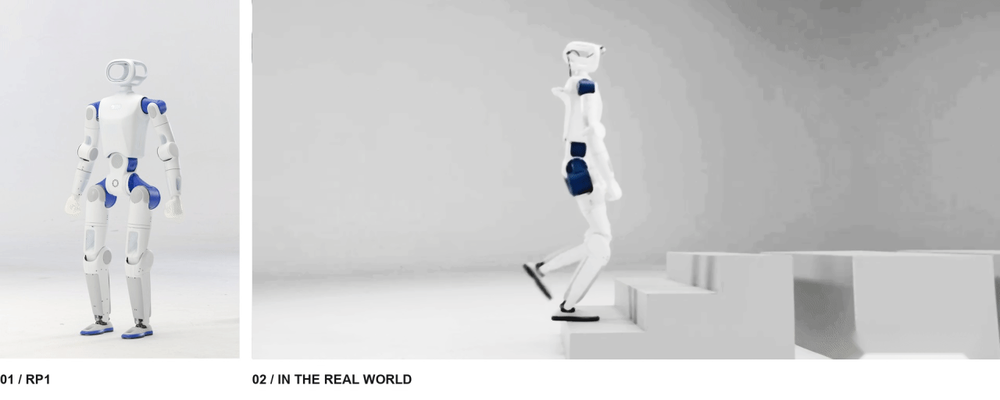
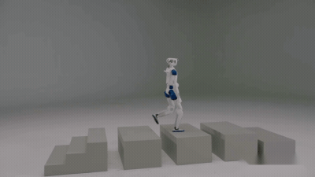
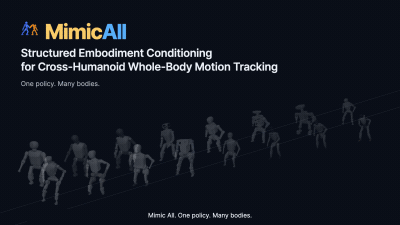

  <strong>English</strong> &nbsp; / &nbsp; <a href="README.zh-CN.md">简体中文</a>

<a href="https://roboparty.com">
  <picture>
    <source media="(max-width: 640px)" srcset="assets/readme/hero-en-mobile.jpg">
    
  </picture>
</a>

<h1 align="center">RP1 · Fully Open-Source Humanoid</h1>

  From mechanical design and electronics to firmware, control and learning. 
  Built to be understood. Open to be built upon.

  <a href="https://roboparty.com"><strong>Website</strong></a> &nbsp; · &nbsp;
  <a href="https://roboparty.com/docs"><strong>Documentation</strong></a> &nbsp; · &nbsp;
  <a href="#repositories"><strong>Repositories</strong></a> &nbsp; · &nbsp;
  <a href="#community"><strong>Community</strong></a>

  
  
  

---

## Open by Design

**RP1 is RoboParty's fully open-source humanoid platform: a shared foundation for building, understanding and extending a real robot.**

The platform brings mechanical and electrical design, joint modules, firmware, robot models, deployment and learning into one connected development stack. Explore a single subsystem, reproduce a build, or develop your own control and learning workflows.

<table width="100%">
<tr>
<td width="33%"><strong>Hardware you can inspect</strong></td>
<td width="33%"><strong>Software you can extend</strong></td>
<td width="33%"><strong>Intelligence you can explore</strong></td>
</tr>
<tr>
<td width="33%">Mechanical CAD, schematics, PCB layouts, Gerber files, BOM and assembly documentation.</td>
<td width="33%">Linux BSP, communication, device interfaces, robot descriptions and deployment modules.</td>
<td width="33%">Locomotion training, motion imitation, tracking and behavior-model projects.</td>
</tr>
</table>

RP1, photographed in the real world.

## One Robot. A Connected Stack.

**No black boxes, nothing withheld — full control handed back to the developer.**

## Explore the Repositories

> Release contents, supported configurations and setup instructions are maintained in each repository.

### Hardware & Robot Models

<table width="100%">
<tr>
<td align="center" width="200"></td>
<td width="150"><a href="https://github.com/Roboparty/RP1_hardware"><strong>RP1_hardware</strong></a></td>
<td width="620">Mechanical source files, electrical topology, schematics, PCB layouts, Gerber files, wiring, thermal design, testing and SOP assembly guides.</td>
</tr>
<tr>
<td align="center" width="200"></td>
<td width="150"><a href="https://github.com/Roboparty/RP1_description"><strong>RP1_description</strong></a></td>
<td width="620">Robot descriptions and geometry: URDF, MJCF and 3D assets; robot and RPhand configurations.</td>
</tr>
<tr>
<td align="center" width="200"></td>
<td width="150"><a href="https://github.com/orgs/Roboparty/teams/romomo"><strong>ROMOMO</strong></a></td>
<td width="620">Joint modules: driver schematics, PCB layouts, Gerber files, firmware and host tools.</td>
</tr>
<tr>
<td align="center" width="200"></td>
<td width="150"><a href="https://github.com/Roboparty/rp_dexhand"><strong>RP-hand</strong></a></td>
<td width="620">RP Hand: product and wiring guides, CAN-FD quick start, Python/C++ SDK integration, ROS 2 compatibility, and model and software resource links.</td>
</tr>
</table>

<strong>Robot configurations & 3D asset</strong>

See the description repository for model files and currently supported configurations.

| Configuration | Description |
| :--- | :--- |
| 24 DoF | 24-DoF configuration |
| 28 DoF | Fixed-head configuration |
| 30 DoF | Configuration with a 2-DoF locomotion head |
| 42 DoF | Configuration with a 2-DoF head and two RPhands |

[Robot description repository](https://github.com/Roboparty/RP1_description) · [Core joint STL](https://github.com/Roboparty/RP1_hardware/blob/main/mechanical/rp1_core_joint.stl)

### Supply Chain

<table width="100%">
<tr>
<td align="center" width="200"></td>
<td width="150"><a href="https://github.com/Taicushier-0212/rp-supplychain-knowhow"><strong>RP_supplychain</strong></a></td>
<td width="620">Humanoid supply-chain know-how: what each part is, where it is used, how to choose and inspect it, plus gates and acceptance criteria.</td>
</tr>
</table>

### Firmware & Deployment

<table width="100%">
<tr>
<td align="center" width="200"></td>
<td width="150"><a href="https://github.com/Roboparty/RP1_firmware"><strong>RP1_firmware</strong></a></td>
<td width="620">Linux BSP, HPM USB-CAN bridge, low-level SDK and software package sources.</td>
</tr>
<tr>
<td align="center" width="200"></td>
<td width="150"><a href="https://github.com/Roboparty/RP1_deploy"><strong>RP1_deploy</strong></a></td>
<td width="620">RoboParty's in-house SDK, covering runtime modules for <code>imu</code>, <code>motor</code>, <code>dexhand</code>, <code>inference</code> and <code>camera</code>.</td>
</tr>
<tr>
<td align="center" width="200"></td>
<td width="150"><a href="https://github.com/Roboparty/rp1_test"><strong>RP1_TEST</strong></a></td>
<td width="620">RP1 full-machine testing.</td>
</tr>
<tr>
<td align="center" width="200"></td>
<td width="150"><a href="https://github.com/Roboparty/roboparty_joystick"><strong>roboparty_joystick</strong></a></td>
<td width="620">Controller and mobile app interfaces for RP1.</td>
</tr>
</table>

### Learning & Behavior

<table width="100%">
<tr>
<td align="center" width="200"></td>
<td width="150"><a href="https://github.com/Roboparty/RP1_train"><strong>RP1_train</strong></a></td>
<td width="620">Walking and running, motion imitation and behavior foundation models.</td>
</tr>
<tr>
<td align="center" width="200"></td>
<td width="150"><strong>RP1_beyondmimic</strong></td>
<td width="620">Dance and motion imitation</td>
</tr>
<tr>
<td align="center" width="200"></td>
<td width="150"><strong>RP1_mimiclite</strong></td>
<td width="620">Motion tracking</td>
</tr>
<tr>
<td align="center" width="200"></td>
<td width="150"><strong>RP1_UFO</strong></td>
<td width="620">Behavior foundation model</td>
</tr>
<tr>
<td align="center" width="200"></td>
<td width="150"><a href="https://github.com/Roboparty/rp1_data"><strong>RP1_DATA</strong></a></td>
<td width="620">Training datasets.</td>
</tr>
</table>

<strong>Related papers</strong>

- **P-BFM: Perceptive Behavioral Foundation Models for Humanoid Control via Unsupervised Reinforcement Learning** — Xue Wang, Yitang Li, Yiming Zhang, Siqin Wang, Junhan Sun, Zhihao Liu, Yaojie Shen, Jingbo Yuan, Hao Zhao, Qingdu Li. *ICLR 2027 (submission)*
- **I-BFM: Reward-Conditioned Robust Humanoid Interaction via Unsupervised Reinforcement Learning** — Ziqi Han. *ICRA (submission)*
- **MimicAll: Structured Embodiment Conditioning for Cross-Humanoid Whole-Body Motion Tracking** — Jia Li. *ICLR (submission)*
- **PREDACTOR** — action-level diffusion for on-device humanoid control — Lei Ye. *ICRA (submission)*
- **From Hitter to Player: Separating Motor Execution and Strategy in Competitive Humanoid Table Tennis** — Fanrong Dong. *ICRA (submission)*
- **Humanoid Parkour** — Fanrong Dong.
- **INTACT** — imitation-to-intent, amortized CEM, lightweight deployment — Junhan Sun. *ICLR (submission)*
- **VIStream: Bringing Inertial Sensing to Streaming Geometric Foundation Models** — Mingzhe Liu. *ICRA (submission)*

## Build From Here

| Your starting point | Where to go |
| :--- | :--- |
| **Understand the platform** | [Documentation & know-how](https://roboparty.com/docs) |
| **Review the supply chain** | [Component know-how & gates](https://github.com/Taicushier-0212/rp-supplychain-knowhow) |
| **Build the hardware** | [Design files & assembly](https://github.com/Roboparty/RP1_hardware) · [Joint modules](https://github.com/orgs/Roboparty/teams/romomo) |
| **Work with robot models** | [URDF, MJCF & 3D assets](https://github.com/Roboparty/RP1_description) |
| **Connect and deploy** | [Firmware & BSP](https://github.com/Roboparty/RP1_firmware) · [Deployment](https://github.com/Roboparty/RP1_deploy) |
| **Train and explore motion** | [Locomotion training](https://github.com/Roboparty/RP1_train) · [Motion imitation](https://github.com/Roboparty/RP1_train) |

Contributions belong in the relevant sub-repository. This overview repository does not accept pull requests; please open issues and pull requests in the project you are working on.

<strong>Behind the scenes</strong>

 

## Built in the Open. Built Together.

Meet the community, share your work, and connect with RoboParty.

  
  
  
  
  
  

<h3 align="center">The RoboParty Ecosystem</h3>

  
  
  

---

  <strong>RoboParty</strong> 
  Open hardware. Open intelligence. Shared possibility.

  GPL-3.0 &nbsp; · &nbsp; © <a href="https://roboparty.com">RoboParty</a> &nbsp; · &nbsp; <a href="#top">Back to top</a> 
  See each sub-repository for its applicable license.

