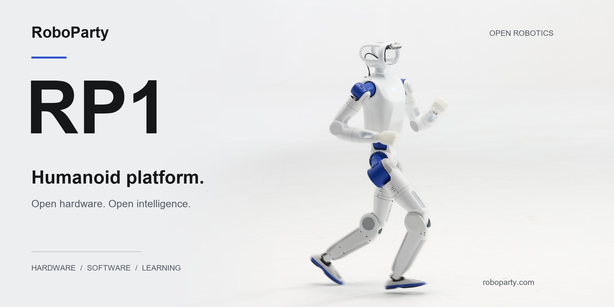

  <strong>English</strong> &nbsp; / &nbsp; <a href="README.zh-CN.md">简体中文</a>

<a href="https://roboparty.com">
  <picture>
    <source media="(max-width: 640px)" srcset="assets/readme/hero-en-mobile.jpg">
    
  </picture>
</a>

<h1 align="center">RP1: An OpenSource Full-Stack Platform for Agentic Humanoids</h1>

  From mechanical design and electronics to firmware, control and learning. 
  Built to be understood. Open to be built upon.

  
  
  

---

## Open by Design

**RP1 is RoboParty's fully open-source humanoid platform: a shared foundation for building, understanding and extending a real robot.**

The platform brings mechanical and electrical design, joint modules, firmware, robot models, deployment and learning into one connected development stack. Explore a single subsystem, reproduce a build, or develop your own control and learning workflows.

<table width="999">
<thead>
<tr><th align="left" width="333">Hardware you can inspect</th><th align="left" width="333">Software you can extend</th><th align="left" width="333">Intelligence you can explore</th></tr>
</thead>
<tbody>
<tr><td valign="top" width="333">Mechanical CAD, schematics, PCB layouts, Gerber files, BOM and assembly documentation.</td><td valign="top" width="333">Linux BSP, communication, device interfaces, robot descriptions and deployment modules.</td><td valign="top" width="333">Locomotion training, motion imitation, tracking and behavior-model projects.</td></tr>
</tbody>
</table>

RP1, photographed in the real world.

## One Robot. A Connected Stack.

<strong>No black boxes, nothing withheld — full control handed back to the developer</strong>

## Explore the Repositories

> Release contents, supported configurations and setup instructions are maintained in each repository.
>
> Contributions belong in the relevant sub-repository. This overview repository does not accept pull requests; please open issues and pull requests in the project you are working on.

### Hardware & Tools

<table width="1000">
<thead>
<tr><th align="left" width="250">Repository</th><th align="left" width="750">Description</th></tr>
</thead>
<tbody>
<tr height="56"><td valign="middle" width="250"><a href="https://github.com/Roboparty/rp1_hardware"><strong>rp1_hardware</strong></a></td><td valign="middle" width="750">Mechanical source files, electronics, testing and assembly SOPs.</td></tr>
<tr height="56"><td valign="middle" width="250"><a href="https://github.com/Roboparty/ROMOMO"><strong>ROMOMO</strong></a></td><td valign="middle" width="750">Joint modules, firmware and host tools.</td></tr>
<tr height="56"><td valign="middle" width="250"><a href="https://github.com/Roboparty/rp_dexhand"><strong>RP-hand</strong></a></td><td valign="middle" width="750">Dexterous hand wiring, CAN-FD communication and SDK integration.</td></tr>
<tr height="56"><td valign="middle" width="250"><a href="https://github.com/Roboparty/rp1_test"><strong>RP1_TEST</strong></a></td><td valign="middle" width="750">RP1 full-machine testing.</td></tr>
<tr height="56"><td valign="middle" width="250"><a href="https://github.com/Roboparty/robot_supplychain"><strong>robot_supplychain</strong></a></td><td valign="middle" width="750">Component selection, inspection, quality gates and acceptance.</td></tr>
<tr height="56"><td valign="middle" width="250"><a href="https://github.com/Roboparty/roboparty_joystick"><strong>roboparty_joystick</strong></a></td><td valign="middle" width="750">RoboParty controller and app.</td></tr>
</tbody>
</table>

<strong>Robot configurations</strong>

See the description repository's current release for supported robot configurations.

Supported configurations include 24, 28, 30 and 42 DoF variants.

### Software & Systems

<table width="1000">
<thead>
<tr><th align="left" width="250">Repository</th><th align="left" width="750">Description</th></tr>
</thead>
<tbody>
<tr height="56"><td valign="middle" width="250"><a href="https://github.com/Roboparty/roboparty_deploy"><strong>roboparty_deploy</strong></a></td><td valign="middle" width="750">Runtime SDK for IMU, motor, dexhand, inference and camera modules.</td></tr>
<tr height="56"><td valign="middle" width="250"><a href="https://github.com/Roboparty/RP1_description"><strong>RP1_description</strong></a></td><td valign="middle" width="750">URDF, MJCF, 3D assets and robot configurations.</td></tr>
<tr height="56"><td valign="middle" width="250"><a href="https://github.com/Roboparty/roboparty_train"><strong>roboparty_train</strong></a></td><td valign="middle" width="750">Locomotion, motion imitation and behavior foundation models.</td></tr>
<tr height="56"><td valign="middle" width="250"><a href="https://github.com/Roboparty/RP1_firmware"><strong>RP1_firmware</strong></a></td><td valign="middle" width="750">Linux BSP, USB-CAN bridge, low-level SDK and packages.</td></tr>
</tbody>
</table>

### Demo

> Coming soon.

<table width="1000">
<thead>
<tr><th align="left" width="250">Project</th><th align="left" width="750">Description</th></tr>
</thead>
<tbody>
<tr height="56"><td valign="middle" width="250"><a href="https://github.com/Roboparty/roboparty_train"><strong>AMP</strong></a></td><td valign="middle" width="750">Learns motion priors from reference motions through adversarial training, supporting natural-looking locomotion and control.</td></tr>
<tr height="56"><td valign="middle" width="250"><a href="https://github.com/Roboparty/roboparty_train"><strong>BeyondMimic</strong></a></td><td valign="middle" width="750">Tracks reference motions to reproduce expressive whole-body movements, including dance and motion-imitation sequences.</td></tr>
<tr height="56"><td valign="middle" width="250"><a href="https://github.com/Roboparty/MimicLite"><strong>MimicLite</strong></a></td><td valign="middle" width="750">Focuses on reference-motion tracking, translating target movements into coordinated whole-body robot actions.</td></tr>
<tr height="56"><td valign="middle" width="250"><a href="https://github.com/Roboparty/UFO"><strong>UFO</strong></a></td><td valign="middle" width="750">Explores a shared behavior foundation for learning and controlling a range of humanoid movements.</td></tr>
<tr height="56"><td valign="middle" width="250"><a href="https://github.com/Roboparty/P-BFM"><strong>PBFM</strong></a></td><td valign="middle" width="750">Connects environmental perception with a behavior foundation model to study movement in relation to the surrounding scene.</td></tr>
<tr height="56"><td valign="middle" width="250"><a href="https://github.com/Roboparty/I-BFM-Code"><strong>IBFM</strong></a></td><td valign="middle" width="750">Focuses on whole-body interaction with the environment, exploring coordinated movements for contact-rich tasks.</td></tr>
<tr height="56"><td valign="middle" width="250"><a href="https://github.com/Roboparty/INTACT-JEPA"><strong>INTACT-JEPA</strong></a></td><td valign="middle" width="750">Learns an intent-to-action mapping with JEPA, translating visual goals into control actions without online search.</td></tr>
</tbody>
</table>

<strong>Related papers</strong>

- **[P-BFM: Perceptive Behavioral Foundation Models for Humanoid Control via Unsupervised Reinforcement Learning](https://arxiv.org/abs/2610.15833)** — Xue Wang, Yitang Li, Yiming Zhang, Siqin Wang, Junhan Sun, Zhihao Liu, Yaojie Shen, Jingbo Yuan, Hao Zhao, Qingdu Li. *ICLR 2027*
- **[I-BFM: Reward-Conditioned Robust Humanoid Interaction via Unsupervised Reinforcement Learning](https://arxiv.org/abs/2610.06129)** — Ziqi Han, Yitang Li, Junhan Sun, Fanrong Dong, Yaojie Shen, Lei Ye, Zetong Jing, Yongqi Zhang, Yiming Zhang, Xue Wang, Hao Zhao. *ICRA*
- **[PredActor: Predictive Action Diffusion for Steerable Onboard Humanoid Control](https://arxiv.org/abs/2609.24840)** — Lei Ye, Haibo Gao, Yitang Li, Peng Xu, Zetong Jing, Junhan Sun, Fanrong Dong, Ziqi Han, Xue Wang, Jianhua Sun, Cewu Lu, Hao Zhao, Liang Ding. *ICRA*
- **[From Hitter to Player: Separating Motor Execution and Strategy in Competitive Humanoid Table Tennis](https://arxiv.org/abs/2610.14067)** — Fanrong Dong, Ziyi Sun, Ziqi Han, Junhan Sun, Lei Ye, Zetong Jing, Hao Zhao, Shaoxun Liu, Rongrong Wang. *ICRA*
- **[INTACT: Isomorphic Intent-to-Action Learning for Search-Free World Models](https://arxiv.org/abs/2607.26056)** — Junhan Sun, Hao Zhao, Guofeng Zhang. *ICLR*
- **[VIStream: Bringing Inertial Sensing to Streaming Geometric Foundation Models](https://github.com/CN-MingZheLiu/vistream)** — Mingzhe Liu. *ICRA*

## Built in the Open. Built Together.

Meet the community, share your work, and connect with RoboParty.

  
  
  
  

<h3 align="center">The RoboParty Ecosystem</h3>

  
  
  
  

---

  <strong>RoboParty</strong> 
  Open hardware. Open intelligence. Shared possibility.

  <a href="https://roboparty.com/docs">GPL-3.0</a> &nbsp; · &nbsp; © <a href="https://roboparty.com">RoboParty</a> &nbsp; · &nbsp; <a href="#top">Back to top</a> 
  See each sub-repository for its applicable license.

