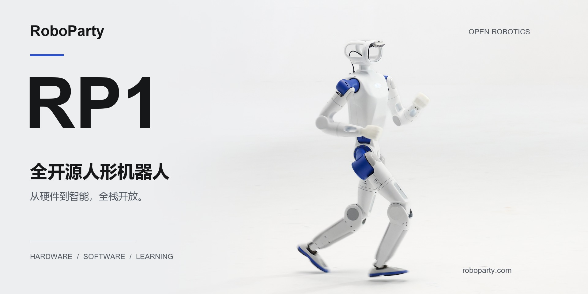
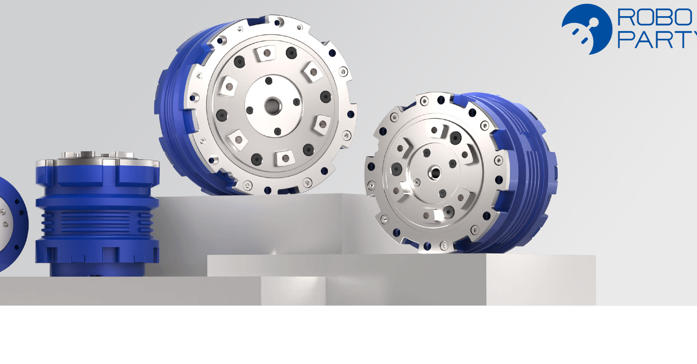

  <a href="README.md">English</a> &nbsp; / &nbsp; <strong>简体中文</strong>

<a href="https://roboparty.com">
  <picture>
    <source media="(max-width: 640px)" srcset="assets/readme/hero-zh-mobile.jpg">
    
  </picture>
</a>

<h1 align="center">RP1: An OpenSource Full-Stack Platform for Agentic Humanoids</h1>

  从机械、电气到固件、控制与学习，全栈开放。 
  让每一层都能被理解，让每一次创新都有起点。

  
  
  

---

## 以开放为起点

**RP1 是 RoboParty 的全开源人形机器人平台：为理解、构建与拓展真实机器人，提供一个共同的研发起点。**

我们将机械与电气设计、关节模组、固件、机器人模型、部署与学习连接为完整的开发体系。你可以深入研究一个子系统，复刻一台机器人，也可以在此基础上探索自己的控制方式与学习流程。

<table width="999">
<thead>
<tr><th align="left" width="333">可查阅的硬件</th><th align="left" width="333">可拓展的软件</th><th align="left" width="333">可探索的智能</th></tr>
</thead>
<tbody>
<tr><td valign="top" width="333">机械 CAD、原理图、PCB 走线、Gerber、BOM 与装配文档。</td><td valign="top" width="333">Linux BSP、通信、设备接口、机器人描述与部署模块。</td><td valign="top" width="333">行走与跑步训练、动作模仿、运动跟踪与行为模型项目。</td></tr>
</tbody>
</table>

从机器人本体，到真实世界中的每一步。

## 一台机器人，完整的开放体系

<strong>我们拒绝黑盒，没有阉割，所见即所得，把对机器人的绝对控制权完整交还开发者</strong>

## 仓库导航

> 具体发布内容、支持配置与安装步骤，以各子仓库维护的信息为准。
>
> 欢迎在对应子仓库参与贡献。本首页仓库不受理 PR；请前往相关项目提交 Issue 或 Pull Request。

### 硬件与工具

<table width="1000">
<thead>
<tr><th align="left" width="250">仓库</th><th align="left" width="750">说明</th></tr>
</thead>
<tbody>
<tr height="56"><td valign="middle" width="250"><a href="https://github.com/Roboparty/rp1_hardware"><strong>rp1_hardware</strong></a></td><td valign="middle" width="750">机械源文件、电气拓扑、原理图、PCB 走线、Gerber、线束、热管理、测试与 SOP 装配指南。</td></tr>
<tr height="56"><td valign="middle" width="250"><a href="https://github.com/Roboparty/ROMOMO"><strong>ROMOMO</strong></a></td><td valign="middle" width="750">关节模组：驱动器原理图、PCB 走线、Gerber、固件与上位机。</td></tr>
<tr height="56"><td valign="middle" width="250"><a href="https://github.com/Roboparty/rp_dexhand"><strong>RP-hand</strong></a></td><td valign="middle" width="750">灵巧手接线、CAN-FD 通信与 SDK 接入。</td></tr>
<tr height="56"><td valign="middle" width="250"><a href="https://github.com/Roboparty/rp1_test"><strong>RP1_TEST</strong></a></td><td valign="middle" width="750">RP1 整机测试相关内容。</td></tr>
<tr height="56"><td valign="middle" width="250"><a href="https://github.com/Roboparty/robot_supplychain"><strong>robot_supplychain</strong></a></td><td valign="middle" width="750">面向人形机器人的供应链实践：元器件选型、供应商评估、来料检验、质量 Gate 与验收标准。</td></tr>
<tr height="56"><td valign="middle" width="250"><a href="https://github.com/Roboparty/roboparty_joystick"><strong>roboparty_joystick</strong></a></td><td valign="middle" width="750">RoboParty 手柄与 App。</td></tr>
</tbody>
</table>

<strong>查看机器人配置</strong>

机器人配置以描述仓库当前发布版本为准。

| 配置 | 说明 |
| :--- | :--- |
| 24 DoF | 24 自由度配置 |
| 28 DoF | 固定头部配置 |
| 30 DoF | 搭载 2 自由度运动头部的配置 |
| 42 DoF | 搭载 2 自由度头部与双 RPhand 的配置 |

### 软件与系统

<table width="1000">
<thead>
<tr><th align="left" width="250">仓库</th><th align="left" width="750">说明</th></tr>
</thead>
<tbody>
<tr height="56"><td valign="middle" width="250"><a href="https://github.com/Roboparty/roboparty_deploy"><strong>roboparty_deploy</strong></a></td><td valign="middle" width="750">RoboParty 自研 SDK，涵盖 <code>imu</code>、<code>motor</code>、<code>dexhand</code>、<code>inference</code>、<code>camera</code> 等几大运行模块。</td></tr>
<tr height="56"><td valign="middle" width="250"><a href="https://github.com/Roboparty/RP1_description"><strong>RP1_description</strong></a></td><td valign="middle" width="750">机器人描述与几何模型：URDF、MJCF、3D 资源，以及机器人和 RPhand 配置。</td></tr>
<tr height="56"><td valign="middle" width="250"><a href="https://github.com/Roboparty/roboparty_train"><strong>roboparty_train</strong></a></td><td valign="middle" width="750">行走与跑步、动作模仿与行为基础模型，含 AMP 与 BeyondMimic。</td></tr>
<tr height="56"><td valign="middle" width="250"><a href="https://github.com/Roboparty/RP1_firmware"><strong>RP1_firmware</strong></a></td><td valign="middle" width="750">Linux 底层 BSP、HPM USB-CAN、底层 SDK 与软件包源。</td></tr>
</tbody>
</table>

### Demo

<table width="1000">
<thead>
<tr><th align="left" width="250">项目</th><th align="left" width="750">说明</th></tr>
</thead>
<tbody>
<tr height="56"><td valign="middle" width="250"><a href="https://github.com/Roboparty/roboparty_train"><strong>AMP</strong></a></td><td valign="middle" width="750">通过对抗训练从参考动作中学习运动先验，用于具有自然动作风格的行走与运动控制。</td></tr>
<tr height="56"><td valign="middle" width="250"><a href="https://github.com/Roboparty/roboparty_train"><strong>BeyondMimic</strong></a></td><td valign="middle" width="750">跟踪参考动作并复现丰富的全身运动，展示舞蹈、动作模仿等连续运动序列。</td></tr>
<tr height="56"><td valign="middle" width="250"><a href="https://github.com/Roboparty/MimicLite"><strong>MimicLite</strong></a></td><td valign="middle" width="750">面向参考动作跟踪，将目标运动转化为机器人协调的全身动作，展示运动复现能力。</td></tr>
<tr height="56"><td valign="middle" width="250"><a href="https://github.com/Roboparty/UFO"><strong>UFO</strong></a></td><td valign="middle" width="750">探索多种人形机器人运动共享的行为基础模型，为不同动作的学习与控制提供统一基础。</td></tr>
<tr height="56"><td valign="middle" width="250"><a href="https://github.com/Roboparty/P-BFM"><strong>PBFM</strong></a></td><td valign="middle" width="750">将环境感知与行为基础模型结合，探索机器人根据周围场景信息进行运动控制的能力。</td></tr>
<tr height="56"><td valign="middle" width="250"><a href="https://github.com/Roboparty/I-BFM-Code"><strong>IBFM</strong></a></td><td valign="middle" width="750">面向机器人与环境的全身交互，探索接触任务中的动作协调，展示翻越箱体等交互动作。</td></tr>
<tr height="56"><td valign="middle" width="250"><a href="https://github.com/Roboparty/INTACT-JEPA"><strong>INTACT-JEPA</strong></a></td><td valign="middle" width="750">基于 JEPA 学习意图到动作的映射，将视觉目标转化为控制动作，无需在线搜索。</td></tr>
</tbody>
</table>

<strong>相关论文</strong>

- **[P-BFM: Perceptive Behavioral Foundation Models for Humanoid Control via Unsupervised Reinforcement Learning](https://arxiv.org/abs/2610.15833)** — Xue Wang, Yitang Li, Yiming Zhang, Siqin Wang, Junhan Sun, Zhihao Liu, Yaojie Shen, Jingbo Yuan, Hao Zhao, Qingdu Li. *ICLR 2027*
- **[I-BFM: Reward-Conditioned Robust Humanoid Interaction via Unsupervised Reinforcement Learning](https://arxiv.org/abs/2610.06129)** — Ziqi Han, Yitang Li, Junhan Sun, Fanrong Dong, Yaojie Shen, Lei Ye, Zetong Jing, Yongqi Zhang, Yiming Zhang, Xue Wang, Hao Zhao. *ICRA*
- **[PredActor: Predictive Action Diffusion for Steerable Onboard Humanoid Control](https://arxiv.org/abs/2609.24840)** — Lei Ye, Haibo Gao, Yitang Li, Peng Xu, Zetong Jing, Junhan Sun, Fanrong Dong, Ziqi Han, Xue Wang, Jianhua Sun, Cewu Lu, Hao Zhao, Liang Ding. *ICRA*
- **[From Hitter to Player: Separating Motor Execution and Strategy in Competitive Humanoid Table Tennis](https://arxiv.org/abs/2610.14067)** — Fanrong Dong, Ziyi Sun, Ziqi Han, Junhan Sun, Lei Ye, Zetong Jing, Hao Zhao, Shaoxun Liu, Rongrong Wang. *ICRA*
- **[INTACT: Isomorphic Intent-to-Action Learning for Search-Free World Models](https://arxiv.org/abs/2607.26056)** — Junhan Sun, Hao Zhao, Guofeng Zhang. *ICLR*
- **[VIStream: Bringing Inertial Sensing to Streaming Geometric Foundation Models](https://github.com/CN-MingZheLiu/vistream)** — Mingzhe Liu. *ICRA*

## 开放共建，连接同行者

交流开发经验，分享你的项目，与 RoboParty 社区一起探索。

  
  
  
  
  
  

<h3 align="center">RoboParty 生态</h3>

  
  
  
  

---

  <strong>RoboParty</strong> 
  硬件开放，智能开放，可能性属于每一个人。

  <a href="https://roboparty.com/docs">GPL-3.0</a> &nbsp; · &nbsp; © <a href="https://roboparty.com">RoboParty</a> &nbsp; · &nbsp; <a href="#top">返回顶部</a> 
  各子仓库的适用许可证以其自身声明为准。

