

  <a href="README.md">English</a> &nbsp; / &nbsp; <strong>简体中文</strong>

<a href="https://roboparty.com">
  <picture>
    <source media="(max-width: 640px)" srcset="assets/readme/hero-zh-mobile.jpg">
    
  </picture>
</a>

<h1 align="center">RP1 · 全开源人形机器人</h1>

  从机械、电气到固件、控制与学习，全栈开放。 
  让每一层都能被理解，让每一次创新都有起点。

  <a href="https://roboparty.com"><strong>官网</strong></a> &nbsp; · &nbsp;
  <a href="https://roboparty.com/docs"><strong>文档</strong></a> &nbsp; · &nbsp;
  <a href="#repositories"><strong>仓库</strong></a> &nbsp; · &nbsp;
  <a href="#community"><strong>社区</strong></a>

  
  
  
  
  

---

## 以开放为起点

**RP1 是 RoboParty 的全开源人形机器人平台：为理解、构建与拓展真实机器人，提供一个共同的研发起点。**

我们将机械与电气设计、关节模组、固件、机器人模型、部署与学习连接为完整的开发体系。你可以深入研究一个子系统，复刻一台机器人，也可以在此基础上探索自己的控制方式与学习流程。

<table width="100%">
<tr>
<td width="33%"><strong>可查阅的硬件</strong></td>
<td width="33%"><strong>可拓展的软件</strong></td>
<td width="33%"><strong>可探索的智能</strong></td>
</tr>
<tr>
<td width="33%">机械 CAD、原理图、PCB 走线、Gerber、BOM 与装配文档。</td>
<td width="33%">Linux BSP、通信、设备接口、机器人描述与部署模块。</td>
<td width="33%">行走与跑步训练、动作模仿、运动跟踪与行为模型项目。</td>
</tr>
</table>

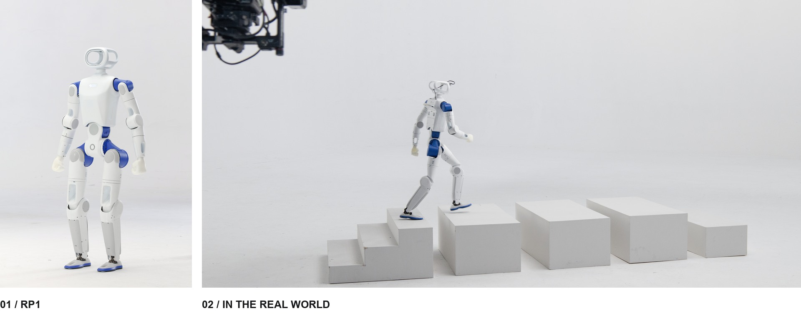

从机器人本体，到真实世界中的每一步。

## 一台机器人，完整的开放体系

**我们拒绝黑盒，没有阉割，所见即所得，把对机器人的绝对控制权完整交还开发者。**

## 仓库导航

> 具体发布内容、支持配置与安装步骤，以各子仓库维护的信息为准。

### 硬件与机器人模型

<table width="100%">
<tr>
<td align="center" width="200">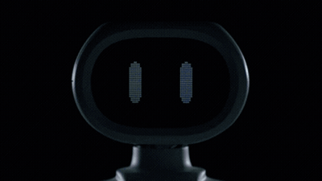</td>
<td width="150"><a href="https://github.com/Roboparty/RP1_hardware"><strong>RP1_hardware</strong></a></td>
<td width="620">机械源文件、电气拓扑、原理图、PCB 走线、Gerber、线束、热管理、测试与 SOP 装配指南。</td>
</tr>
<tr>
<td align="center" width="200">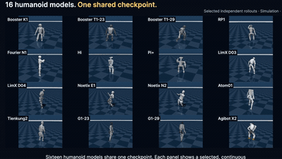</td>
<td width="150"><a href="https://github.com/Roboparty/RP1_description"><strong>RP1_description</strong></a></td>
<td width="620">机器人描述与几何模型：URDF、MJCF、3D 资源，以及机器人和 RPhand 配置。</td>
</tr>
<tr>
<td align="center" width="200">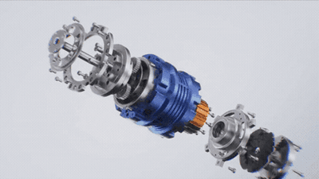</td>
<td width="150"><a href="https://github.com/Roboparty/ROMOMO"><strong>ROMOMO</strong></a></td>
<td width="620">关节模组：驱动器原理图、PCB 走线、Gerber、固件与上位机。</td>
</tr>
<tr>
<td align="center" width="200">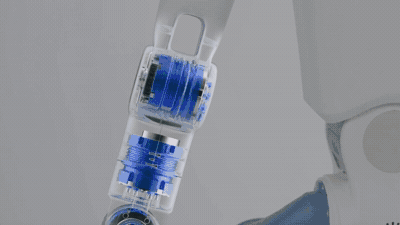</td>
<td width="150"><a href="https://github.com/Roboparty/rp_dexhand"><strong>rp_dexhand</strong></a></td>
<td width="620">RP Hand 灵巧手：产品与接线手册、CAN-FD 快速上手、Python/C++ SDK 接入、ROS 2 兼容说明及模型与软件资源入口。</td>
</tr>
</table>

<strong>查看机器人配置与 3D 资源</strong>

机器人配置与模型文件，以描述仓库当前发布版本为准。

| 配置 | 说明 |
| :--- | :--- |
| 24 DoF | 24 自由度配置 |
| 28 DoF | 固定头部配置 |
| 30 DoF | 搭载 2 自由度运动头部的配置 |
| 42 DoF | 搭载 2 自由度头部与双 RPhand 的配置 |

[机器人描述仓库](https://github.com/Roboparty/RP1_description) · [核心关节 STL](https://github.com/Roboparty/RP1_hardware/blob/main/mechanical/rp1_core_joint.stl)

### 固件与部署

<table width="100%">
<tr>
<td align="center" width="200">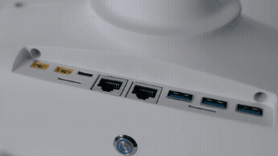</td>
<td width="150"><a href="https://github.com/Roboparty/RP1_firmware"><strong>RP1_firmware</strong></a></td>
<td width="620">Linux 底层 BSP、HPM USB-CAN、底层 SDK 与软件包源。</td>
</tr>
<tr>
<td align="center" width="200">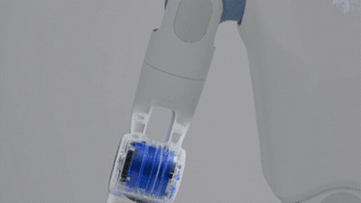</td>
<td width="150"><a href="https://github.com/Roboparty/RP1_deploy"><strong>RP1_deploy</strong></a></td>
<td width="620">RoboParty 自研 SDK，涵盖 <code>imu</code>、<code>motor</code>、<code>dexhand</code>、<code>inference</code>、<code>camera</code> 等几大运行模块。</td>
</tr>
<tr>
<td align="center" width="200"></td>
<td width="150"><a href="https://github.com/Roboparty/RP1_joystick"><strong>RP1_joystick</strong></a></td>
<td width="620">RP1 手柄与手机 App 接口。</td>
</tr>
</table>

### 学习与行为

<table width="100%">
<tr>
<td align="center" width="200">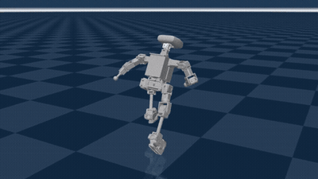</td>
<td width="150"><a href="https://github.com/Roboparty/RP1_train"><strong>RP1_train</strong></a></td>
<td width="620">行走与跑步</td>
</tr>
<tr>
<td align="center" width="200">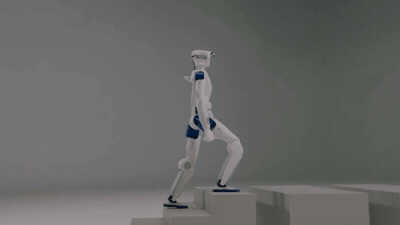</td>
<td width="150"><a href="https://github.com/Roboparty/RP1_beyondmimic"><strong>RP1_beyondmimic</strong></a></td>
<td width="620">舞蹈与动作模仿</td>
</tr>
<tr>
<td align="center" width="200">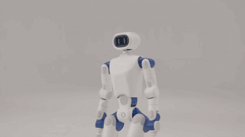</td>
<td width="150"><a href="https://github.com/Roboparty/RP1_mimiclite"><strong>RP1_mimiclite</strong></a></td>
<td width="620">运动跟踪</td>
</tr>
<tr>
<td align="center" width="200">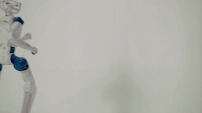</td>
<td width="150"><a href="https://github.com/Roboparty/RP1_UFO"><strong>RP1_UFO</strong></a></td>
<td width="620">行为基础模型</td>
</tr>
<tr>
<td align="center" width="200">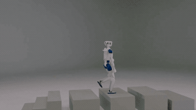</td>
<td width="150"><a href="https://github.com/Roboparty/RP1_PBFM"><strong>RP1_PBFM</strong></a></td>
<td width="620">感知行为基础模型</td>
</tr>
<tr>
<td align="center" width="200">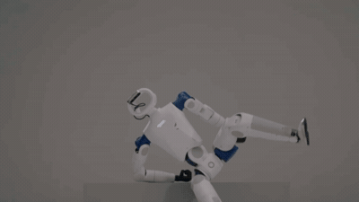</td>
<td width="150"><a href="https://github.com/Roboparty/RP1_IBFM"><strong>RP1_IBFM</strong></a></td>
<td width="620">交互行为基础模型</td>
</tr>
</table>

<strong>相关论文</strong>

- **P-BFM: Perceptive Behavioral Foundation Models for Humanoid Control via Unsupervised Reinforcement Learning** — Xue Wang, Yitang Li, Yiming Zhang, Siqin Wang, Junhan Sun, Zhihao Liu, Yaojie Shen, Jingbo Yuan, Hao Zhao, Qingdu Li. *ICLR 2027 (submission)*
- **I-BFM: Reward-Conditioned Robust Humanoid Interaction via Unsupervised Reinforcement Learning** — Ziqi Han. *ICRA (submission)*
- **MimicAll: Structured Embodiment Conditioning for Cross-Humanoid Whole-Body Motion Tracking** — Jia Li. *ICLR (submission)*
- **PREDACTOR** — action-level diffusion for on-device humanoid control — Lei Ye. *ICRA (submission)*
- **From Hitter to Player: Separating Motor Execution and Strategy in Competitive Humanoid Table Tennis** — Fanrong Dong. *ICRA (submission)*
- **Humanoid Parkour** — Fanrong Dong.
- **INTACT** — imitation-to-intent, amortized CEM, lightweight deployment — Junhan Sun. *ICLR (submission)*
- **VIStream: Bringing Inertial Sensing to Streaming Geometric Foundation Models** — Mingzhe Liu. *ICRA (submission)*

## 从这里开始

| 你想做什么 | 推荐入口 |
| :--- | :--- |
| **了解平台** | [开发文档与 Know-how](https://roboparty.com/docs) |
| **构建硬件** | [设计文件与装配](https://github.com/Roboparty/RP1_hardware) · [关节模组](https://github.com/Roboparty/ROMOMO) |
| **使用机器人模型** | [URDF、MJCF 与 3D 资源](https://github.com/Roboparty/RP1_description) |
| **连接与部署** | [固件与 BSP](https://github.com/Roboparty/RP1_firmware) · [运行部署](https://github.com/Roboparty/RP1_deploy) |
| **训练与探索动作** | [运动训练](https://github.com/Roboparty/RP1_train) · [动作模仿](https://github.com/Roboparty/RP1_beyondmimic) |

欢迎在对应子仓库参与贡献。本首页仓库不受理 PR；请前往相关项目提交 Issue 或 Pull Request。

<strong>镜头背后</strong>

 
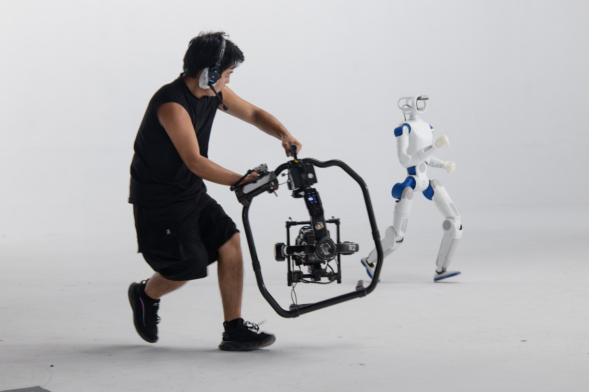

## 开放共建，连接同行者

交流开发经验，分享你的项目，与 RoboParty 社区一起探索。

  
  
  
  
  
  

<h3 align="center">RoboParty 生态</h3>

  
  
  

---

  <strong>RoboParty</strong> 
  硬件开放，智能开放，可能性属于每一个人。

  GPL-3.0 &nbsp; · &nbsp; © <a href="https://roboparty.com">RoboParty</a> &nbsp; · &nbsp; <a href="#top">返回顶部</a> 
  各子仓库的适用许可证以其自身声明为准。

